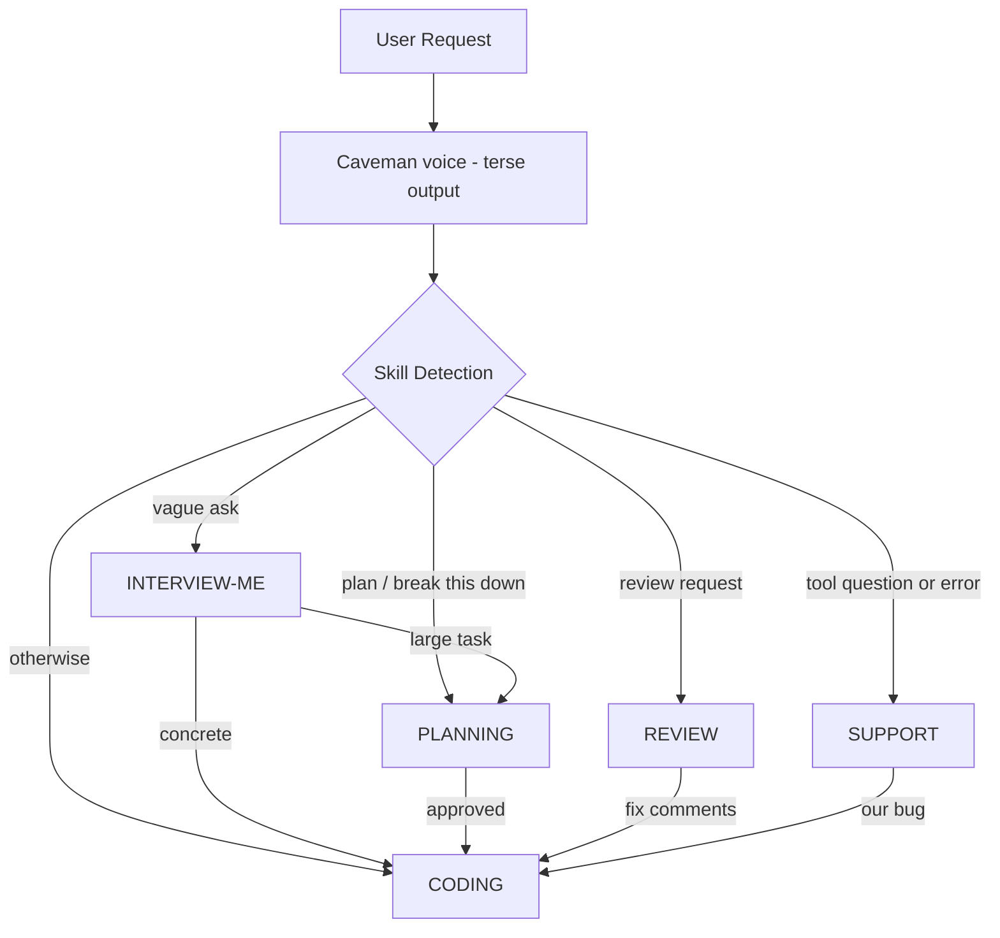
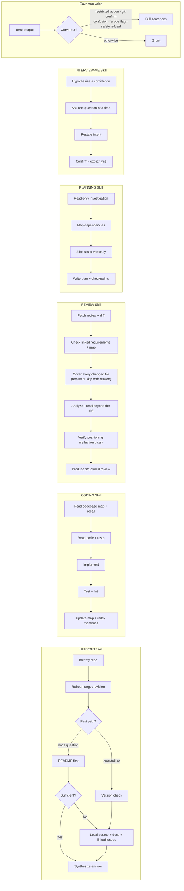
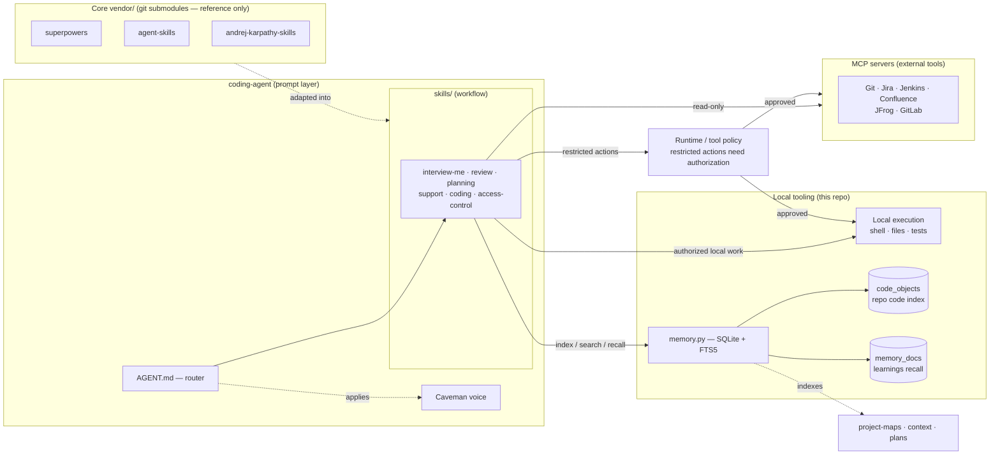
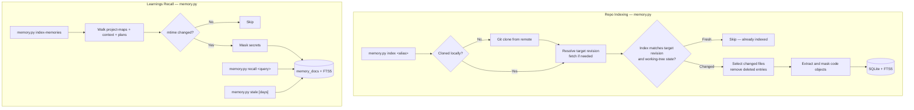

# My Coding Agent

Runs locally with repository checkouts and persistent memory, using MCP for external integrations.

Five skills: **interview-me**, **coding**, **code review**, **planning**, and **support**.

## Why These Features

- **Local clones:** Avoid repeated MCP source reads, network latency, and token-heavy responses. Reuse checkouts and indexes; remove disposable clones when unused, keeping maps and learnings.
- **Project map:** Quickly locate entry points, modules, and dependencies.
- **Index and memory:** Find code and reuse past decisions. Current source remains authoritative.
- **Security gate:** Require authorization for restricted local and MCP actions.

### Vendors and credits

| Source | Why we use it | Role in this agent |
| --- | --- | --- |
| [andrej-karpathy-skills](https://github.com/forrestchang/andrej-karpathy-skills) | Simple solutions, explicit assumptions, focused changes. | CODING discipline and REVIEW scope checks. |
| [agent-skills](https://github.com/addyosmani/agent-skills) | Repeatable steps from clarification to verified implementation. | INTERVIEW-ME, PLANNING, CODING, and REVIEW workflows. |
| [superpowers](https://github.com/obra/superpowers) | Root-cause debugging and evidence before claiming success. | SUPPORT investigations and CODING validation. |
| [mattpocock/skills](https://github.com/mattpocock/skills) | Clear instructions, simple module interfaces, shared domain terms. | Knowledge docs, architecture guidance, and retrospectives. |
| [Caveman](https://github.com/JuliusBrussee/caveman/tree/main) | Shorter responses and fewer output tokens; exact code preserved. | Shared voice; full sentences for approvals, clarification, and safety. |

Selected guidance is adapted into local skills. Vendor repositories are references, not runtime dependencies.

## How It Works

### Skill routing

Route by intent; URLs identify the repository or change.



### Per-skill flows



### Components: skills, submodules, MCP servers, memory






## Skills

| Skill | Trigger | What it does |
| --- | --- | --- |
| **INTERVIEW-ME** | Vague request, "interview me" | Clarifies intent before plan/code |
| **REVIEW** | "review this commit", review request | Review changes against requirements |
| **PLANNING** | "plan this", large multi-file task | Ordered task list with acceptance criteria |
| **SUPPORT** | Tool question, error report, pasted logs | README-first answers, version checks, Jira/Git searches |
| **CODING** | Everything else | Implement, debug, test, update docs |


## Shared Infrastructure

### `config.yaml` — Repo Registry

Shared registry of repository aliases, clone paths, and search keywords.

### `memory.py` — Repo Indexing

Local SQLite/FTS5 search for source code and saved learnings.

Features:

- **On-demand clones** — reuse local checkouts across tasks; re-clone after cleanup.
- **Cleanup** — remove only disposable, inactive, agent-managed clones with no uncommitted changes or unpushed commits; retain maps and memory.
- **Freshness** — refresh the target revision as needed; track revision and working-tree state; update changed and deleted entries.
- **Code object extraction** — functions, classes, YAML keys, shell functions
- **Credential masking** — regex and entropy checks before storing source or memory.

### `knowledge/` — Reference Material

| File | Purpose |
| --- | --- |
| `troubleshooting.md` | Structured triage: reproduce → localize → narrow → diagnose → resolve |
| `backward-compatibility.md` | Breaking change detection for coding, review, and support |
| `prompt-templates.md` | Reusable patterns for repo identification, version checks, log analysis |
| `complexity-classification.md` | Auto-think: TRIVIAL/STANDARD/COMPLEX task classification |
| `tool-recovery.md` | Tool-specific error recovery with retry hints |
| `writing-for-agents.md` | Guide for authoring skill/steering docs: context pointers, progressive disclosure, no-op pruning |
| `session-state-template.md` | Templates for repo index, hindsight, and session checkpoints |

## Example Requests

```text
# Support: how to use a tool
> how do I use doc tool to generate HTML?

# Support: investigate an error
> project Fun build fail!

# Review a commit:
> review my latest commit

# Plan a large feature:
> plan the implementation for adding this chat feature

# Write code:
> add retry logic to chat client
```

## Access Control

`skills/access-control.md` defines restricted actions. Runtime permissions and tool policies must enforce these boundaries for local commands and MCP calls. The actions below require scoped user authorization; routine edits within the requested scope can proceed.

| Category | Examples |
| --- | --- |
| **Network** | Open ports, change firewall/iptables, modify DNS/proxy/routing |
| **Production** | Any action targeting prod systems, clusters, or databases |
| **Deployment** | helm install, kubectl apply, docker push |
| **Configuration** | System configs, K8s ConfigMaps/Secrets, .env for running services |
| **Credentials** | Tokens, SSH/GPG keys, RBAC, certificates |
| **Data & State** | Delete databases, purge queues, bulk-delete files |

Runtime data (gitignored):

```text
memory.db    # SQLite database for repo indexes + code objects
repos/       # Local clones of repos (auto-cloned)
```
